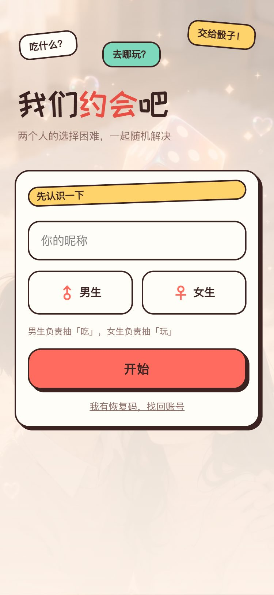
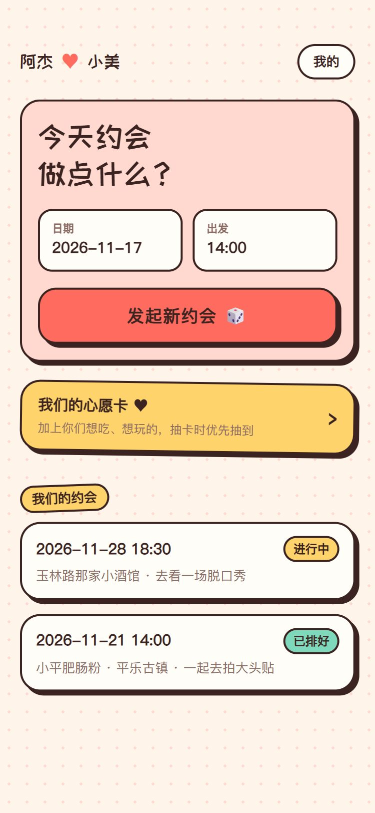
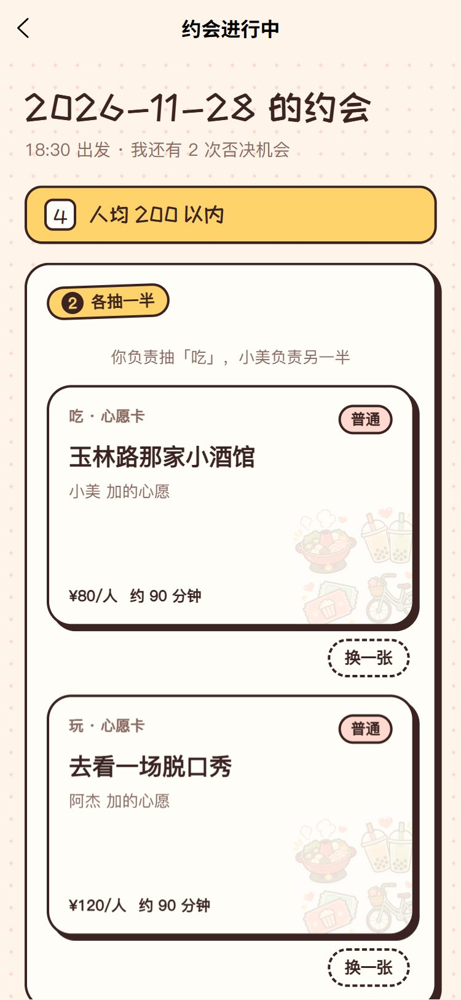
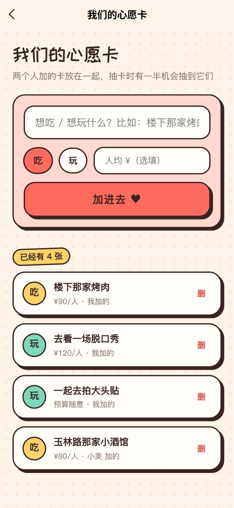
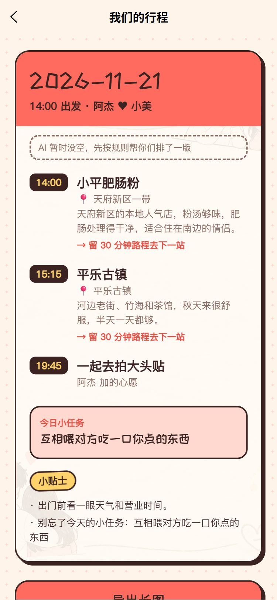

# 我们约会吧

情侣约会决策 App。两个人每次都卡在“吃什么、去哪玩”，这个 App 把选择交给骰子和抽卡：掷骰子定预算，两人各抽一半，双方都同意后自动排好一份约会行程。

目前以成都为主，内置 296 张点子卡（成都 205 张，哪个城市都能用的通用卡 91 张）和 47 条情侣小任务，也可以添加你们自己想去的地方。

<p align="center">
  
  
  
  
  
</p>
<p align="center"><sub>欢迎页 · 首页 · 约会进行中 · 我们的心愿卡 · 排好的行程</sub></p>

## 怎么玩

1. **注册并绑定**：每人填昵称和性别，再填一份“雷区问卷”，比如不吃辣、怕恐怖、不想早起。一方生成 6 位邀请码，另一方输入就绑定好了。
2. **发起约会**：任意一方选好日期和出发时间。
3. **掷骰子定预算**：1–6 点分别对应人均 50 / 100 / 150 / 200 / 300 / 不限。
4. **各抽一半**：男生抽“吃”，女生抽“玩”；两人性别相同时，邀请方抽“吃”。每人只能在自己手机上抽自己那一半，抽到的卡两边都能实时看到。
5. **盲盒和刮刮乐（都可选）**：盲盒再抽一张惊喜卡，按普通、稀有、惊喜三档稀有度加权；刮刮乐刮出一条小任务，比如“互相喂对方吃一口你点的东西”。
6. **不满意就换**：每人每次约会有 2 次否决机会，可以换掉任意一张卡。
7. **就这么定了**：两人都确认后，由 AI（DeepSeek）排出时间线、路线和小贴士。没配 AI 或 AI 超时（15 秒）时，按规则排一份兜底行程。行程可以导出长图，也可以复制分享链接，对方用浏览器就能打开。

**我们的心愿卡**：两个人都能把自己想吃、想玩的地方加进去，绑定后这些卡两人共用。抽卡时如果有符合预算的心愿卡，有一半机会抽到它们。

抽卡时会自动避开两人雷区的并集，也会过滤掉超出骰子预算的卡。所有随机都在服务端完成，两台手机看到的结果一致。

## 技术栈

| 部分 | 用的是 |
|---|---|
| 客户端 `app/` | uni-app（Vue 3 + Vite + TypeScript），首发安卓，用 HBuilderX 云打包 |
| 服务端 `server/` | Node.js 20.12+、Express 5、better-sqlite3 |
| AI 排行程 | DeepSeek API（可选，不配也能完整使用） |
| 同步 | 两台手机每 2 秒轮询一次约会状态，不用 WebSocket |

## 本地运行

需要 Node.js 20.12 或更高版本。

**1. 启动服务端**

```bash
cd server
npm install
cp .env.example .env   # 可选：在 .env 里填 DEEPSEEK_API_KEY，不填就用兜底行程
npm start              # http://localhost:3000
```

启动时会自动把 `data/` 里的点子卡和小任务导入 SQLite（`server/date.db`）。

**2. 启动客户端（浏览器预览）**

```bash
cd app
npm install
npm run dev:h5         # 默认 http://localhost:5173，请求 http://localhost:3000
```

建议把浏览器切到手机尺寸，开两个窗口（或一个普通窗口加一个无痕窗口）分别注册一男一女，就能体验两人同步抽卡。

**3. 打包安卓 App**

1. 复制 `app/.env.production.example` 为 `app/.env.production`，把 `VITE_API_BASE` 改成你服务器的地址。
2. 用 HBuilderX 打开 `app/`，选择“发行 → 原生 App-云打包”。

## 运行测试

```bash
cd server
npm test               # 45 项：接口、玩法规则、数据导入、AI 兜底
node ../data/scripts/validate.mjs   # 校验知识库格式
```

## 目录结构

```
app/        uni-app 客户端（pages/ 页面，components/ 骰子、点子卡、刮刮卡组件）
server/     Express 服务端（src/app.js 接口，src/game.js 玩法规则，src/ai.js DeepSeek）
data/       知识库：ideas.json 点子卡、tasks.json 小任务、sources.md 来源说明
docs/       方案 spec.md、进度 progress.md、README 截图
```

接口清单和完整玩法规则见 [docs/spec.md](docs/spec.md)。

## 数据来源

点子卡来自公开网页（澎湃、携程、知乎等）的成都约会内容，由 AI 补足一部分。卡片描述都用自己的话改写，没有照抄原文，每张卡的 `source` 字段记录了出处。没有采集小红书和大众点评。详细来源见 [data/sources.md](data/sources.md)。

## 致谢

标题字体使用 [站酷快乐体 ZCOOL KuaiLe](https://github.com/googlefonts/zcool-kuaile)，遵循 SIL Open Font License 1.1。App 里只打包了常用字子集，授权文件见 [app/src/static/fonts/ZCOOL-KuaiLe-OFL.txt](app/src/static/fonts/ZCOOL-KuaiLe-OFL.txt)。
